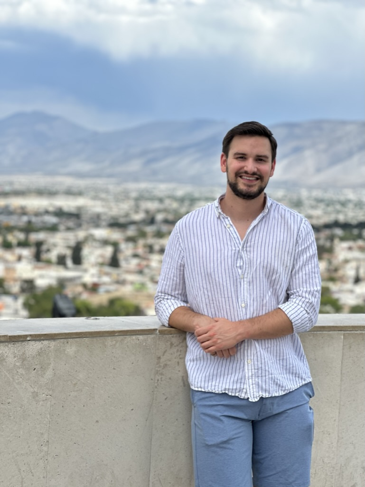

---
# the default layout is 'page'
icon: fas fa-info-circle
order: 5
---

I'm Dario, a cyber security engineer working at [American Express](https://www.americanexpress.com) helping keep customer data secure.

I graduated from the [University of Texas at San Antonio](https://www.utsa.edu/) where I double majored in Cyber Security & Information Systems.

I work in cybersecurity, with a focus on protecting data. My background covers customer support, networking, operating systems and system administration, and that range is most of what makes security problems make sense to me. I hold the CISSP and I'm usually studying for the next thing.

Interests: Cyber Security, Cloud, AI, Automation, Philosophy

{: w="487" h="262" }
_Me at the peak of [Saltillo, Mexico](https://en.wikipedia.org/wiki/Saltillo)_